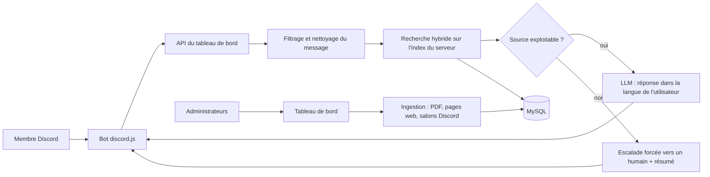

# Bot de support Discord à base de RAG : documentation d'architecture

Bot de support multilingue pour serveurs Discord, qui répond à partir de la base de connaissances propre à chaque serveur, et un tableau de bord d'administration pour la gérer.
Quand aucune source exploitable n'est trouvée, le bot ne répond pas : il transmet le cas à un humain avec un résumé.

> Documentation uniquement. Le code source du projet est privé.

## Contexte et statut

- Projet développé en solo pour la partie technique ; mon associé s'est occupé du marketing.
- Statut : **arrêté**. Le projet a été arrêté lorsque Discord a bloqué les nouvelles invitations (limite de 100 serveurs sans vérification du bot).
- Ce dépôt ne contient ni code du produit, ni prompts, ni schéma de base de données : uniquement une description de conception et un petit module d'exemple réécrit à neuf.

## Architecture

Deux applications : un bot (discord.js) qui reçoit les messages, et un tableau de bord (SvelteKit + Prisma + MySQL) qui porte la logique de réponse, l'ingestion et l'administration.

Recherche hybride, en quatre temps :

1. La question est transformée en embedding (OpenAI) ; les embeddings des chunks du serveur sont stockés dans MySQL.
2. Le cosinus est calculé en mémoire, côté application, sur les chunks de ce serveur uniquement (un index séparé par serveur).
3. Les candidats retenus par la voie vectorielle sont reclassés lexicalement : fraction des termes de la requête présents dans le chunk, en mot entier.
4. Les deux classements sont fusionnés par Reciprocal Rank Fusion (RRF).

Le classement lexical ne porte que sur les candidats déjà retenus par la voie vectorielle : il reclasse, il n'élargit pas le jeu de candidats. Voir [docs/architecture.md](docs/architecture.md) pour les diagrammes détaillés.

## Garde-fous

- **Escalade forcée dans le code.** Si aucune source exploitable n'est trouvée alors que des documents sont indexés, le backend force l'escalade et supprime le corps de la réponse du modèle, même si celui-ci a répondu. La règle n'est pas qu'une consigne de prompt. Le ticket est transmis à l'équipe avec un résumé généré. Exceptions : messages sociaux courts (salutations), et serveur sans aucun document indexé en contexte de ticket.
- **Filtrage d'injections de prompt** : les messages et contextes utilisateur sont filtrés par motifs avant d'entrer dans le prompt ; ce filtre est heuristique et ne prétend pas être exhaustif.
- **Captures d'écran** : OCR local d'abord, puis repli sur un LLM multimodal quand le texte extrait est insuffisant ou l'OCR échoue.
- **Multilingue** : la langue de l'utilisateur est détectée et la réponse est rédigée dans cette langue ; la requête peut être traduite vers une langue pivot avant la recherche.
- **Réglages de confiance par serveur** : chaque serveur dispose de son seuil de confiance, réglable par ses administrateurs.
- **Suivi** : scores de recherche, latence et coût estimé par appel LLM sont journalisés.

## Décisions et compromis

Détail dans [docs/decisions.md](docs/decisions.md). En résumé :

- MySQL comme stockage des vecteurs, par contrainte d'hébergement, au prix d'un cosinus calculé en mémoire.
- Reclassement lexical limité aux candidats vectoriels, plutôt qu'un second index.
- Fusion RRF, qui ne demande pas de rendre comparables des scores de natures différentes.
- Escalade appliquée dans le code, pas seulement dans le prompt.
- Un index logique par serveur.

## Limites connues

- Les vecteurs sont lus en base puis comparés en mémoire : le coût de chaque requête croît avec la taille de l'index du serveur, et le nombre de chunks chargés par requête est plafonné.
- Au-delà d'environ 200 Mo de données, il faudrait un moteur vectoriel dédié (pgvector ou Qdrant).
- Le reclassement lexical est limité aux candidats de la voie vectorielle : un chunk pertinent mais mal classé par les embeddings n'est pas récupéré par la voie lexicale.
- Le seuil du garde-fou d'évidence dépend de la géométrie du modèle d'embeddings choisi : il nécessite un recalibrage dédié à chaque changement de modèle.
- Les salons Discord sont lus comme contexte ; ils ne passent pas par l'index vectoriel.
- Le filtrage d'injections est à base de motifs : il réduit le risque sans l'éliminer.

## Usage et résultats

Ordres de grandeur d'usage :

- environ 100 serveurs ;
- plus de 300 administrateurs ;
- environ 200 Mo de données.

Aucune mesure de qualité de réponse n'est publiée ici.

## Stack

TypeScript, SvelteKit, Prisma, MySQL, discord.js, embeddings OpenAI.

## Licence

Le module d'exemple du dossier [example/](example/) (fusion RRF et score de recouvrement lexical, réécrit à neuf et indépendant du projet privé) est sous licence MIT : voir [LICENSE](LICENSE). Le reste du dépôt est de la documentation.

## Contact

[Nikola Gandon sur LinkedIn](https://www.linkedin.com/in/nikola-gandon/)
