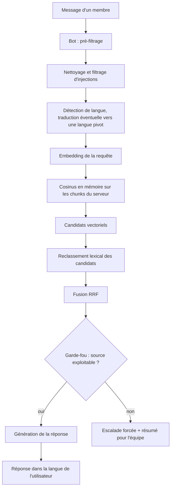
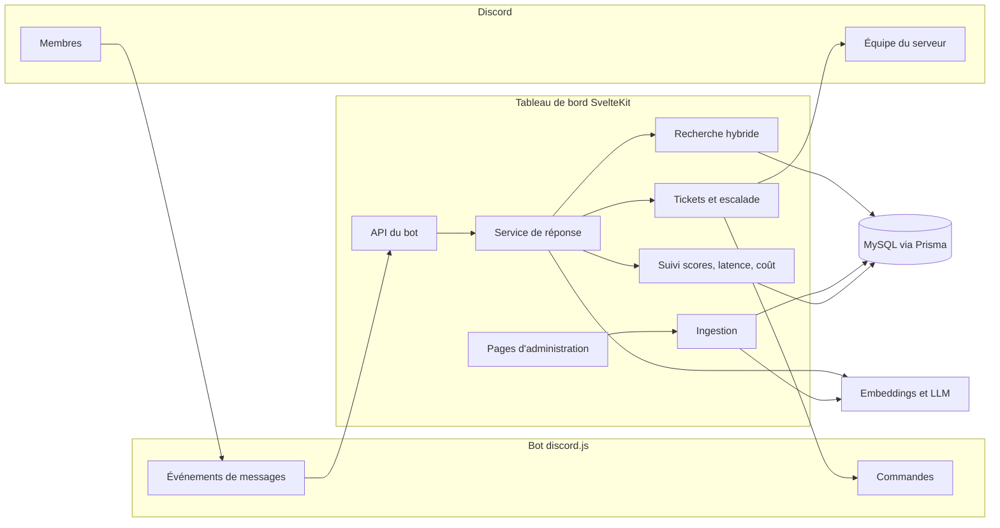
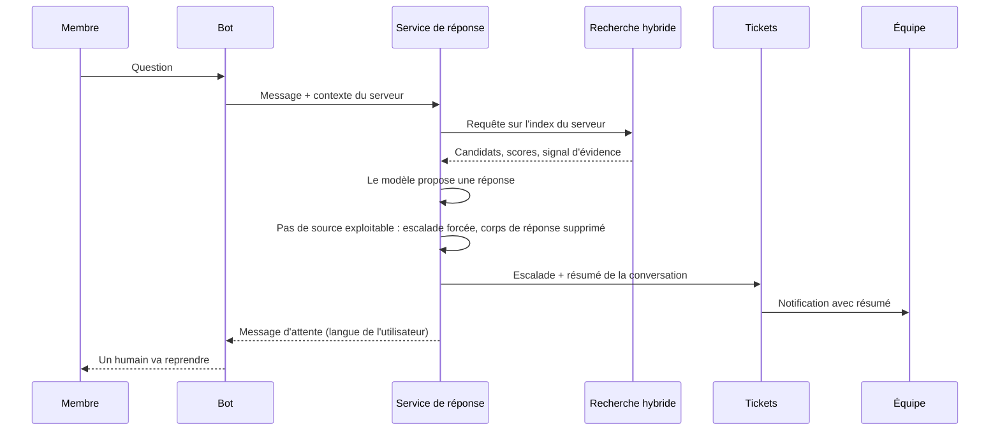

# Architecture

Vue de conception, volontairement sans code, prompts ni schéma. Les valeurs de réglage de production ne sont pas publiées.

## 1. Flux principal d'une question

Légende : le garde-fou d'évidence est évalué dans le code après la recherche. Un échec force l'escalade quelle que soit la sortie du modèle. Les captures d'écran suivent un chemin parallèle (OCR, puis LLM multimodal en repli) dont le texte est ajouté au contexte.

## 2. Composants

Légende : le bot ne porte pas la logique de réponse ; elle est centralisée dans le tableau de bord. Les administrateurs alimentent la base (PDF, pages web) et règlent la confiance par serveur. Les salons Discord de connaissance sont lus comme contexte.

## 3. Séquence : une question sans source exploitable

Légende : même si le modèle produit une réponse, la décision d'escalade appartient au code. Le résumé évite à l'équipe de relire toute la conversation.

## Notes de conception

- Isolation : chaque requête de recherche est restreinte à l'index du serveur concerné.
- Vecteurs : stockés en base avec le nom du modèle d'embeddings, pour ne comparer que des vecteurs de même modèle pendant une migration.
- Observabilité : scores et latence de recherche, tokens, durée et coût estimé de chaque appel LLM.
